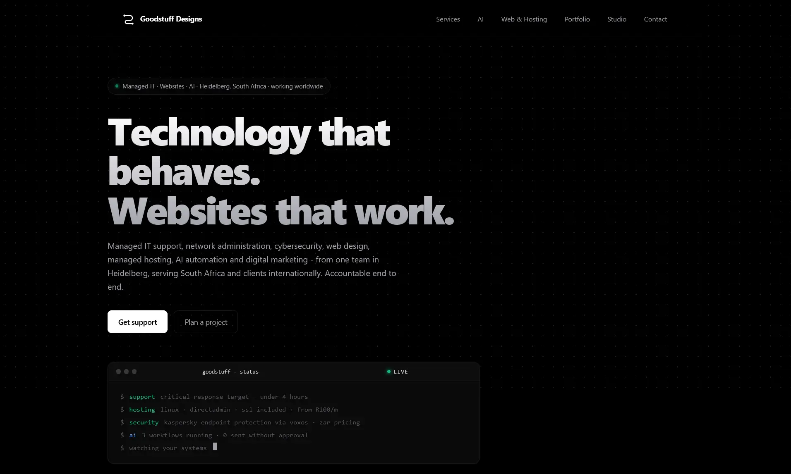
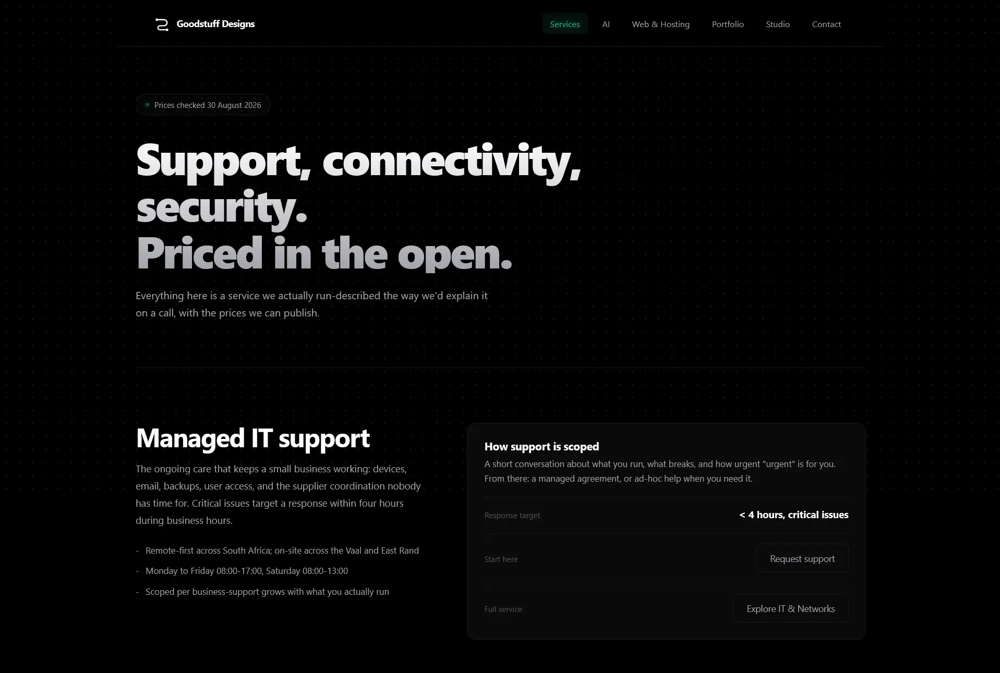
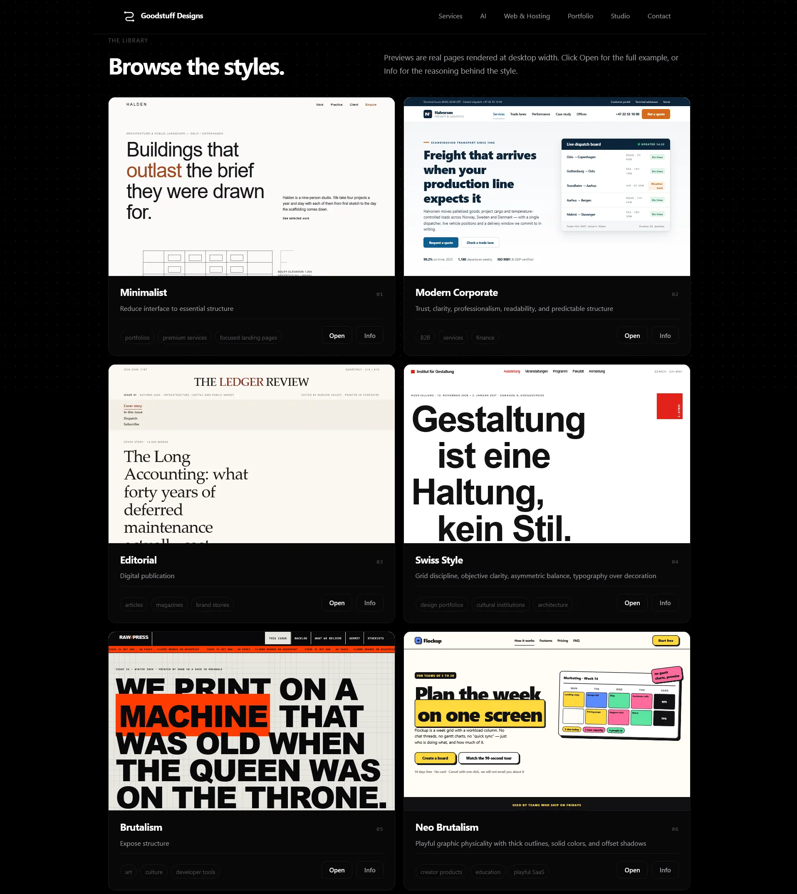
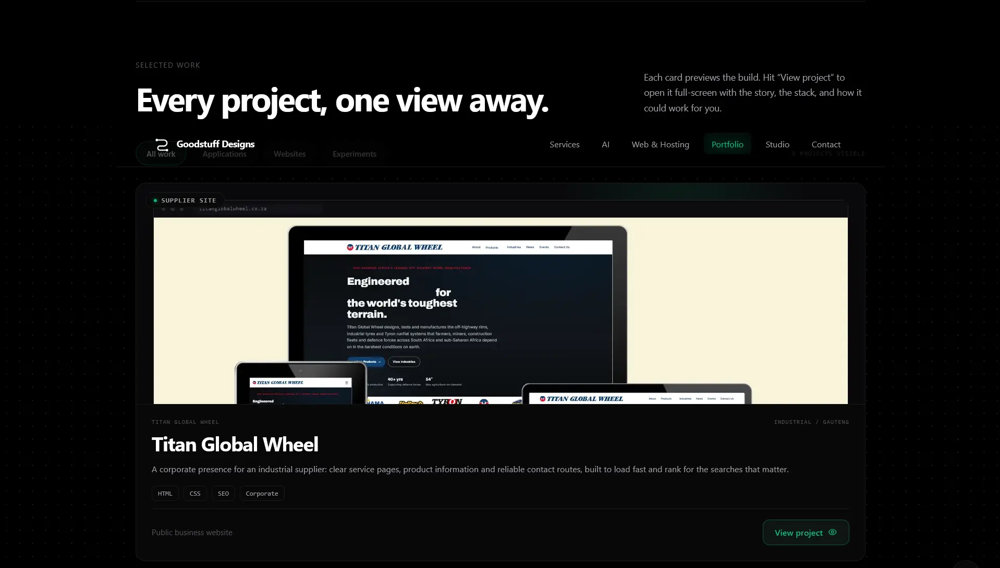

<h1 align="center">
  Goodstuff Designs Website
</h1>

<p align="center">
  <strong>The production static website for Goodstuff Designs (Pty) Ltd</strong><br/>
  A framework-free, dark-themed marketing and services site with a privacy-first analytics layer,<br/>
  machine-readable content for AI agents, and zero build tooling.
</p>

<p align="center">
  <a href="https://goodstuffdesigns.co.za">Live site</a> ·
  <a href="https://goodstuffdesigns.co.za/services">Services</a> ·
  <a href="https://goodstuffdesigns.co.za/portfolio">Portfolio</a> ·
  <a href="https://github.com/Code-NameCode">GitHub</a>
</p>

<p align="center">
  
  
  
  
  
  
</p>

---

## Table of contents

1. [About the project](#about-the-project)
2. [Features](#features)
3. [Screenshots](#screenshots)
4. [Technology stack](#technology-stack)
5. [Getting started](#getting-started)
6. [Project structure](#project-structure)
7. [Architecture](#architecture)
8. [Configuration](#configuration)
9. [Machine-readable layer](#machine-readable-layer)
10. [Analytics and consent](#analytics-and-consent)
11. [Deployment](#deployment)
12. [Development guide](#development-guide)
13. [Performance](#performance)
14. [Security](#security)
15. [Known limitations](#known-limitations)
16. [FAQ](#faq)
17. [Credits and license](#credits-and-license)

---

## About the project

This repository holds the complete static build of [goodstuffdesigns.co.za](https://goodstuffdesigns.co.za), the public website for Goodstuff Designs — a technology studio in Heidelberg, Gauteng, South Africa offering managed IT support, business networks and fibre connectivity, Kaspersky security, websites and managed Linux hosting, AI services, and digital marketing.

The build is deliberately plain: **13 hand-authored HTML pages, one shared stylesheet, and five small vanilla-JS modules.** There is no framework, no bundler, no package manager and no build step. Every page loads as authored, which keeps time-to-first-byte low, removes dependency churn entirely, and makes the whole site auditable by reading it.

What makes this build distinctive is the layer beneath the markup:

- **Consent before code.** Google Consent Mode v2 and Microsoft Clarity consent signals are set *before* any analytics tag loads. If a visitor rejects, `analytics_storage` stays denied and existing analytics cookies are actively cleared — the site never relies on a banner that quietly ignores "no".
- **Machine-readable by design.** Every content page has a Markdown mirror served as `text/markdown`, the site publishes `llms.txt`, an agent resource directory (`.well-known/ard.json`), and JSON catalogues — plus five registered [WebMCP](https://github.com/ModelContextProtocol) tools that let compatible in-browser agents search services, list pages, quote pricing and start enquiries directly from the live DOM.
- **Twin deployment configs.** A `vercel.json` (clean URLs, security headers, immutable asset caching) ships alongside a byte-for-byte-compatible `.htaccess` twin, so the same folder deploys unchanged to Vercel or to the company's own DirectAdmin/Apache hosting.

It is designed for the business's own customers first, and for AI agents, crawlers and Lighthouse second — both audiences get an honest, complete view of the same content.

## Features

### Pages and content

| Page | Route | What it does |
|---|---|---|
| Homepage | `/` | Hero, terminal status card, proof band, service bento grid, Vox fibre tab explorer, Kaspersky tier picker, hosting metrics, FAQ (JSON-LD `FAQPage`) |
| Services | `/services` | Interactive five-tab service console, Vox ISP pricing grid, Kaspersky price tiers, engagement process |
| IT & Networks | `/it-and-networks` | Seven anchored SEO sections: network administration, IT support, cybersecurity, monitoring, AI operations, infrastructure, managed services |
| Websites & Hosting | `/websites-and-hosting` | Website/e-commerce offerings, four-stage delivery track, three Linux hosting plans |
| AI | `/ai` | Human-controlled AI workflows, integrations, AI-assisted support and marketing |
| Digital Marketing | `/digital-marketing` | Measurement, social, Google Ads and reporting sections with a live ROI calculator |
| Design Styles | `/design-styles` | Live-iframe gallery of the `examples/` library (80+ named styles), lazy-loaded ten at a time |
| Portfolio | `/portfolio` | Filterable project grid with browser-framed previews and a full project viewer modal |
| Studio | `/studio` | Goodstuff-Studio desktop app product page with screenshot carousel (JSON-LD `SoftwareApplication`) |
| Contact | `/contact` | Three enquiry routes (support / project / hosting) that prefill the form; masked in Clarity |
| Privacy · Cookies · 404 | `/privacy`, `/cookie-policy`, `/404` | POPIA-aligned policy pages and a custom not-found route |

Every page shares one identical navbar and footer (with per-page active state), is fully responsive down to mobile widths, and honours `prefers-reduced-motion`.

### Interactive functionality

- **Cookie consent banner** (`assets/js/consent.js`) — injected once per browser, remembers the choice in both `localStorage` and a cookie so a blocked-cookie browser still keeps its answer, exposes a persistent "Cookie settings" footer control, and offers accept/reject with equal prominence.
- **Consent bootstrap** (`assets/js/consent-bootstrap.js`) — sets GA4 Consent Mode v2 defaults and `ads_data_redaction` before tags load.
- **Shared motion layer** (`assets/js/motion.js`) — IntersectionObserver scroll reveals with stagger, safe without JavaScript, fully disabled under reduced motion.
- **Self-healing nav** (`assets/js/main.js`) — normalises clean URLs, marks the active page, keeps the shared Services link present on older pages, injects favicon/manifest links when missing, and wires the mobile menu with Escape-to-close.
- **Portfolio project viewer** — sticky inspector with browser-framed live previews per project card.
- **Design styles gallery** — lazy iframes that only fetch when scrolled near, so "view all" never loads 80 pages at once.

### Agent and machine interfaces

- Five WebMCP tools registered on `document.modelContext`: `search_services`, `list_site_pages`, `get_service_pricing`, `list_integrations`, `start_contact_enquiry` — read-only catalogue access plus a navigation helper, with JSON Schemas and read-only annotations.
- Markdown mirrors (`index.md`, `services.md`, …) served as `text/markdown` and linked from each page with `<link rel="alternate" type="text/markdown">`.
- `llms.txt`, `service-catalog.json`, `ai-catalog.json` and `.well-known/ard.json` for crawlers and assistants.
- JSON-LD structured data per page: `Organization`, `FAQPage`, `BreadcrumbList`, `SoftwareApplication`, `WebPage`.

## Screenshots

### Core pages

<div align="center">
  
  <p><sub><strong>Homepage</strong> — hero with live terminal status card, proof band and service bento grid.</sub></p>
  
  <p><sub><strong>Services</strong> — five-tab service console, Vox ISP pricing grid and Kaspersky tiers, all priced in the open.</sub></p>
  
  <p><sub><strong>Design Styles</strong> — 80+ named styles rendered as lazy-loaded live iframes.</sub></p>
  
  <p><sub><strong>Portfolio</strong> — filterable project grid; every card opens a full project viewer.</sub></p>
</div>

### Portfolio preview assets

Individual project previews referenced by the portfolio page live in `assets/projects/`:

| Preview | File |
|---|---|
| Titan Global Wheel | `assets/projects/globalwheel.webp` |
| Nietbegin Stables | `assets/projects/nietbeginwebsite.webp` |
| APJ Capital | `assets/projects/apjcapital.webp` |
| The Project Vault | `assets/projects/project-vault-cover.png` |
| React Admin Dashboard | `assets/projects/ReactDashboard.webp` |
| React Budget App | `assets/projects/BudgetApp.webp` |
| React CV Generator | `assets/projects/CVGen.webp` |
| Heli Maze Game | `assets/projects/helimaze.webp` |

## Technology stack

| Layer | Choice | Notes |
|---|---|---|
| Markup | HTML5 | 13 semantic pages, JSON-LD per page |
| Styling | Modern CSS | One 59 KB shared stylesheet (`assets/css/styles.css`), custom properties, grid, 13 responsive breakpoints, reduced-motion support |
| Behaviour | Vanilla JS (ES2020+) | Five small modules, no frameworks, no transpilation |
| Fonts | Inter + JetBrains Mono | Self-hosted via Google Fonts `<link>` |
| Analytics | GA4 + Microsoft Clarity | Gated behind Consent Mode v2 |
| Hosting | Vercel (`vercel.json`) or Apache/DirectAdmin (`.htaccess`) | Twin configs, identical behaviour |
| Icons | Inline SVG | No icon library |

Runtime dependencies: **none.** There is no `package.json`, no lockfile, no CDN script and no build pipeline — by design.

## Getting started

### Prerequisites

- Any modern browser for viewing.
- Any static file server for local work (some interactive features fetch JSON and dislike `file://`). For example Python:

```bash
# from the repository root
python -m http.server 8000
```

Then open <http://localhost:8000>.

There are no dependencies to install and no build step:

```bash
git clone https://github.com/Code-NameCode/<this-repository>.git
cd <this-repository>
python -m http.server 8000   # or npx serve . or VS Code Live Server
```

Editing files is the entire workflow — save and refresh.

## Project structure

```
.
├── index.html                 # Homepage
├── services.html              # Service console
├── it-and-networks.html       # Managed IT, networks, cybersecurity (7 SEO sections)
├── websites-and-hosting.html  # Web + hosting offers and plans
├── ai.html                    # AI services
├── digital-marketing.html     # Measurement, social, Ads, reporting
├── design-styles.html         # Live-iframe style gallery
├── portfolio.html             # Filterable project grid + viewer
├── studio.html                # Goodstuff-Studio product page
├── contact.html               # Route-aware enquiry form
├── privacy.html / cookie-policy.html / 404.html
├── *.md                       # Markdown mirrors (served as text/markdown)
├── assets/
│   ├── css/styles.css         # The shared design system (tokens, components, responsive)
│   ├── js/
│   │   ├── tracking-config.js # Consent + measurement IDs (single config point)
│   │   ├── consent-bootstrap.js # GA4 Consent Mode defaults, pre-tag
│   │   ├── consent.js         # Banner, persistence, vendor updates, cookie clearing
│   │   ├── main.js            # Nav normalisation, WebMCP tools, pricing data
│   │   └── motion.js          # Scroll reveals, reduced-motion aware
│   ├── img/                   # Logo + favicon (SVG)
│   ├── projects/              # Portfolio preview images (webp/png)
│   └── DESIGN.md              # Design system documentation
├── docs/
│   └── DISCOVERY.md           # Full architecture inventory of the build
├── examples/                  # 80+ standalone design-style demo pages
├── attachments/               # Working images used during development
├── .well-known/ard.json       # Agent resource directory
├── ai-catalog.json            # AI service catalogue + WebMCP tool manifests
├── service-catalog.json       # Public service catalogue incl. price matrix
├── llms.txt                   # Guide for AI agents
├── sitemap.xml / sitemap.md / robots.txt
├── vercel.json                # Clean URLs, headers, caching, redirects
└── .htaccess                  # Apache twin of the Vercel config
```

## Architecture

**One stylesheet, five scripts, no build.** Each page declares its own page-scoped styles inline (the shared stylesheet covers tokens, nav, footer, cookie banner and common components), so a page can be redesigned without touching the others. The navbar and footer are authored per page but kept identical by convention — `assets/js/main.js` repairs drift (e.g. re-adding the shared Services link) at runtime.

**Load order on every page:**

```
tracking-config.js        → frozen config object (IDs, cookie name, TTL)
consent-bootstrap.js      → gtag("consent","default",…) BEFORE any tag loads
consent.js                → builds the banner if no choice exists; wires footer "Cookie settings"
main.js                   → nav/footer repair, WebMCP tool registration
motion.js (defer)         → scroll reveals
```

**Consent flow:** the choice lives in `localStorage` first (survives cookie blocking) with the `gsd_consent_v1` cookie as fallback. On reject, `consent.js` updates GA4 Consent Mode to denied, informs Clarity via `consentv2`, and actively expires `_ga*/_cl*` cookies at both host and dot-domain scope.

**Clean URLs:** the server layer maps `/services` → `services.html`, 301-redirects `.html` URLs to their clean form, and keeps legacy `/web-development` and `/hosting` routes pointing at `/websites-and-hosting` (declared in both `vercel.json` and `.htaccess`).

**Design tokens:** dark-only theme — `#000000` background, `#10b981` emerald accent, Inter for text and JetBrains Mono for labels/terminals. Full specification in [`assets/DESIGN.md`](assets/DESIGN.md).

## Configuration

All measurement configuration lives in one frozen object — [`assets/js/tracking-config.js`](assets/js/tracking-config.js):

```js
window.goodstuffTrackingConfig = Object.freeze({
  consentVersion: "1",
  cookieName: "gsd_consent_v1",
  consentMaxAgeSeconds: 15552000,   // 180 days
  ga4MeasurementId: "G-GK6GRLG54F",
  clarityProjectId: "yamfms9iti"
});
```

| Key | Purpose |
|---|---|
| `consentVersion` | Bumping it re-asks visitors whose saved choice was made under an older version |
| `cookieName` | Storage key used for both the cookie and the `localStorage` mirror |
| `consentMaxAgeSeconds` | Cookie lifetime for the saved choice |
| `ga4MeasurementId` / `clarityProjectId` | Vendor IDs; tracking stays inactive while blank |

Content prices and catalogue data live in `service-catalog.json`, `ai-catalog.json` and the `pricing` object in `main.js`, each stamped with a `checked` date that must be refreshed when public prices change.

## Machine-readable layer

For agents and crawlers the site publishes parallel views of the same content:

- **`llms.txt`** — company profile, key pages, machine resources and behavioural notes.
- **`*.md` mirrors** — one per content page, served with `Content-Type: text/markdown` and advertised via `<link rel="alternate">`.
- **`.well-known/ard.json`** — agent resource directory entries with representative queries per page.
- **`ai-catalog.json`** — services, products, pages, contact actions, WebMCP tool manifests and redirects in one document.
- **WebMCP tools** (registered by `main.js` when `document.modelContext` exists) — `search_services`, `list_site_pages`, `get_service_pricing`, `list_integrations`, `start_contact_enquiry`. All are read-only except the last, which only navigates to `/contact?route=…` and explicitly does not send anything.

## Analytics and consent

The pipeline is consent-first end to end:

1. `consent-bootstrap.js` sets Consent Mode v2 defaults: `analytics_storage` granted only if a prior acceptance exists; `ad_*` always denied; `ads_data_redaction` on.
2. GA4 and Clarity load only after that, and Clarity is additionally configured with masking on contact inputs.
3. The banner (`consent.js`) writes the choice, updates both vendors, and clears analytics cookies on rejection.
4. Meaningful actions (enquiry submissions, phone/WhatsApp clicks, hosting plan selections, social link clicks) are pushed to `dataLayer` as events for conversion measurement.

`robots.txt` allows all crawlers and explicitly welcomes Chrome-Lighthouse so PageSpeed Insights can fetch CSS, JS and images.

## Deployment

**Vercel** — import the repository; `vercel.json` provides `cleanUrls`, no trailing slash, security headers, `text/markdown` headers for mirrors, and one-year immutable caching for `/assets/*`. No build command is needed — output is the repository as-is.

**Apache / DirectAdmin** — upload the same folder; `.htaccess` mirrors the rewrite and redirect behaviour (clean URLs, `.html` → clean 301s, legacy routes, custom 404).

No environment variables are required. Everything is static.

## Development guide

- **Run locally:** `python -m http.server 8000` (or `npx serve .`) from the root.
- **No build, lint or test tooling exists** — there is deliberately nothing to run. Editing files and refreshing is the whole loop.
- **Cache busting:** shared assets are referenced with query-string versions (e.g. `consent.js?v=consent-7`); bump the string when changing a shared file.
- **Cross-page edits:** when changing the navbar, footer or cookie banner markup, apply the identical change to every page — consistency across all 13 pages is a project convention, and `consent.js` re-injects the banner and footer controls on any page missing them.
- **Design system:** consult [`assets/DESIGN.md`](assets/DESIGN.md) before introducing tokens or components.
- **Contributing:** this is the company's production site, not an open-source library. Spot a factual error or broken link? Open an issue on the repository and it will be fixed.

## Performance

- No framework runtime, no hydration, no bundler overhead — HTML renders as delivered.
- `/assets/*` served with `Cache-Control: public, max-age=31536000, immutable` on Vercel.
- Portfolio previews and gallery iframes use `loading="lazy"`; the design-styles gallery fetches iframes only as they approach the viewport.
- Scroll animations use a single `IntersectionObserver` and never hide content when JavaScript is absent or reduced motion is requested.

## Security

- Headers on every response (via `vercel.json`): `X-Content-Type-Options: nosniff`, `Referrer-Policy: strict-origin-when-cross-origin`, `Permissions-Policy` locking camera, microphone and geolocation.
- No backend, no forms processing in this repository (enquiries post to the company's separate backend), so there is no server-side attack surface here.
- Consent choices are written `Secure; SameSite=Lax` on HTTPS.
- Third-party surface is limited to GA4 and Clarity, both governed by Consent Mode and disabled by default.

## Known limitations

- No light mode — the theme is intentionally dark-only.
- The design-styles gallery requires the `examples/` folder to be deployed alongside the core pages.
- Legacy Generation-1 CSS tokens still exist in `styles.css` for older components; new work should use the Generation-2 tokens in `DESIGN.md`.
- Analytics IDs are committed in `tracking-config.js`; they are client-public by nature, but this means forks would report into the same properties until the IDs are changed.

## FAQ

**Why no framework?**
The site is content marketing with light interactivity. A framework would add a build step, a dependency audit surface and a migration treadmill without improving what visitors experience. Plain HTML ships faster and outlives tooling trends.

**How do clean URLs work without a framework?**
`vercel.json` (`cleanUrls: true`) on Vercel, and rewrite rules in `.htaccess` on Apache, map `/services` to `services.html` and 301 the `.html` forms.

**Where is the cookie banner implemented?**
Entirely client-side in `assets/js/consent.js`, which builds the banner DOM, persists the choice and updates vendors. Pages don't need to include banner markup — it self-injects.

**Can agents read the pricing?**
Yes — via the WebMCP `get_service_pricing` tool, `service-catalog.json`, or the markdown mirrors. Prices are stamped with the date they were verified.

## Credits and license

Built and maintained by **Goodstuff Designs (Pty) Ltd** — Heidelberg, Gauteng, South Africa.

- Website: <https://goodstuffdesigns.co.za>
- GitHub: <https://github.com/Code-NameCode>
- Project Vault (archive of built work): <https://code-namecode.github.io/Project-Vault/>
- Contact: admin@goodstuffdesigns.co.za · +27 79 937 4801

Design system documentation lives in [`assets/DESIGN.md`](assets/DESIGN.md); the full architecture inventory in [`docs/DISCOVERY.md`](docs/DISCOVERY.md).

**License — all rights reserved.** Content, design and code are © Goodstuff Designs (Pty) Ltd. Public for reference; reuse requires permission.

---

<p align="center">
  <sub>Technology that works. Support that stays.</sub>
</p>
